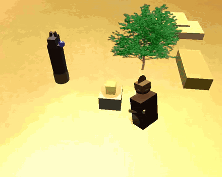

# The Pharaoh's Curse

A 78-second real-time 3D animated short in **C++ and OpenGL**: an explorer steals a sacred idol, wakes an ancient Pharaoh, and is chased into a pyramid by the Pharaoh and a Mummy Warrior who rises from the sand.




*Highlights preview, rendered from the project.* **[Watch the full 78 s animation with sound (MP4)](docs/demo.mp4)**

## Run it

| | How | Time |
|---|---|---|
| **1. Watch** | Open the [full animation video](docs/demo.mp4). No setup needed. | 1 min |
| **2. Play** | Download `PharaohsCurse-Windows.zip` from the [Releases page](../../releases), unzip it, and double-click `assig2.exe`. Keep the `resources` folder next to the exe. | 2 min |
| **3. Build** | See [Build from source](#build-from-source). | 15 min |

## Story

An explorer steals a golden idol from its plinth. A guardian statue's orb flares from blue to red, the Pharaoh awakens in his sarcophagus, and a Mummy Warrior bursts out of the desert. Both chase the explorer across the necropolis and into the Great Pyramid, while a scripted drone-style camera follows the action from day into night.

## Screenshots

| | | |
|:---:|:---:|:---:|
|  |  |  |
| The theft | The Pharaoh awakens | The Mummy rises |
|  |  |  |
| The chase | Into the pyramid | The cursed necropolis |

## Technical Highlights

- **Hierarchical scene graph:** characters are composite objects (13 child parts each) where moving a parent carries all its children.
- **Independent animation:** limbs, head and body are animated separately through class methods (`animateRun()`, `animateArmL()`, `animateRise()`, ...).
- **Sweeps and extrusions:** bandaged mummy arms, hieroglyph chest plate, hat brim and statue staff are generated from profile files.
- **Texturing and transparency:** textured bodies and terrain, a see-through mummy cape and a glowing aura around the idol.
- **Dynamic lighting:** day-to-night transition plus a real point light in the statue's orb that changes colour as the curse wakes.
- **Cinematic camera and audio:** a 13-phase scripted camera and looping ambience through irrKlang (`.ogg`).

<details>
<summary><b>Character hierarchies</b></summary>

```
composite1  (Mummy Warrior)
└── body  [textured bandage wrap]
    ├── neck → head [textured] → eyeL, eyeR (emissive), crown, headdressL, headdressR
    ├── armL  [SWEEP]   (independently animated)
    ├── armR  [SWEEP]   (independently animated)
    ├── legL, legR
    ├── chest [EXTRUSION: hieroglyph cartouche]
    └── cape  [TRANSPARENT]

composite2  (Explorer)
└── torso  [textured shirt]
    ├── neck → head → hair, hat → brim [SWEEP]
    ├── armL, armR  (independently animated)
    ├── legL, legR
    ├── satchel, satchelBadge [EXTRUSION]
    └── treasure → glowAura [TRANSPARENT]
```
</details>

<details>
<summary><b>Controls</b></summary>

The animation starts automatically and runs about 78 seconds.

| Key | Action |
|-----|--------|
| `A` | Restart the animation |
| `P` | Pause / resume |
| `F` | Toggle fullscreen |
| `Shift + F` | Unlimit / limit the frame rate |
| `Q` / `Esc` | Quit |
</details>

## Build from source

**Requirements:** Windows, Visual Studio 2022 (toolset v143), Win32 platform, and the libraries supplied with the course base code: **GLUT, GLEW, SOIL and irrKlang**. They are not included in this repository.

1. Clone the repository.
2. Put the `.lib` files in `support/` and the `.dll` files next to the built exe.
3. Open `assig2.sln` and select **Release | Win32**.
4. Press **Ctrl + F5**. Visual Studio starts the program in the project folder, which is where `resources/` is found.

<details>
<summary><b>Project structure</b></summary>

```
basicsource/       Entry point and scene.cpp (story, timing, camera)
objects-student/   composite1 (Mummy), composite2 (Explorer), Pharaoh,
                   PyramidStructure, TombGuardianStatue, DesertPalms
objects-standard/  Course-supplied primitives (cube, sphere, sweep, extrusion, ...)
support/           Course-supplied engine code (object3d, camera, light, texture, skybox, sound)
resources/         Textures, skybox images, sweep/extrusion profiles, audio
docs/              Screenshots and demo video
```
</details>

## Credits

- Built on the **Computer Graphics course base framework** at Zhejiang University of Technology. The characters, scene, story, animation and camera choreography were written for this project.
- Ambience: *Dark Pyramid Night Ambience Loop* by szegvari ([Freesound #534876](https://freesound.org/s/534876/)).
- Skybox: `sky22` night-sky image set.

## Author

**Taha Rhoulam** · [github.com/TahaRhoulam](https://github.com/TahaRhoulam)
