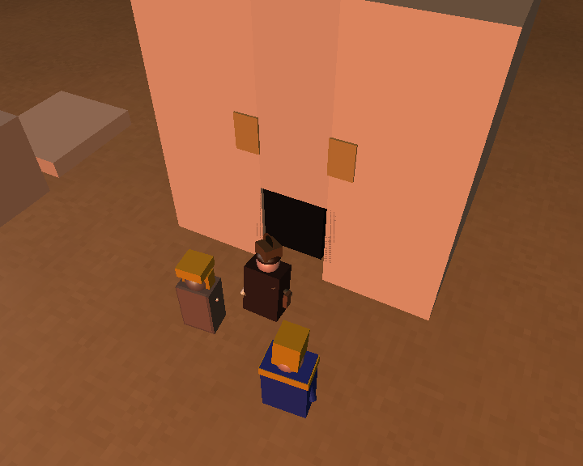
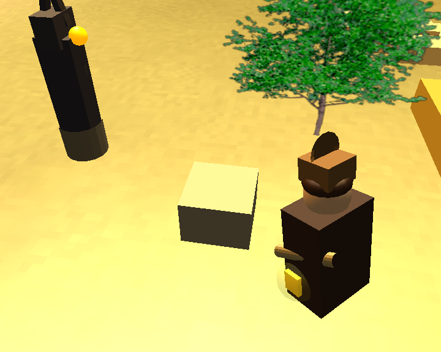
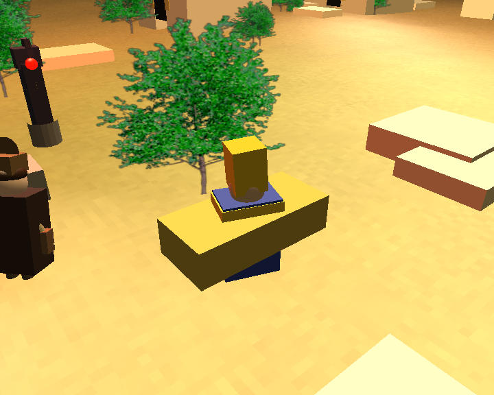
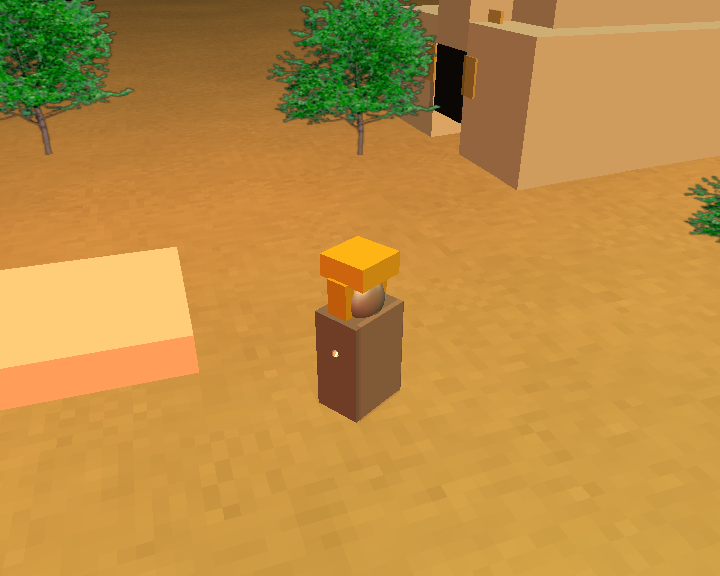
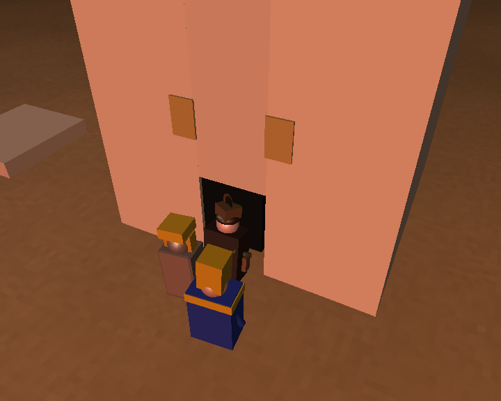
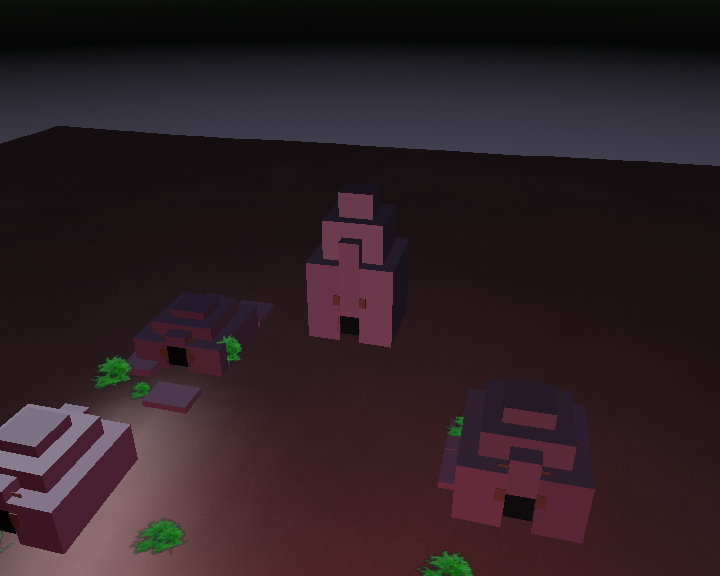

# The Pharaoh's Curse

A 78-second real-time 3D animated short, written in **C++ and OpenGL**. An explorer steals a sacred golden idol, awakens an ancient Pharaoh, and is chased into a pyramid by the Pharaoh and a Mummy Warrior who rises from the desert sand.


-0078D6)



## Story

> An explorer steals a sacred treasure, the ancient Pharaoh awakens, a Mummy Warrior rises from the sand, and both chase the explorer inside the pyramid.

The animation plays out in 13 timed phases, driven by a scripted drone-style camera:

| Time | Event |
|------|-------|
| 0 – 12 s | The explorer approaches the treasure plinth and steals the golden idol |
| 12 – 19 s | The Pharaoh awakens in his sarcophagus, rises and points at the thief |
| 19 – 26 s | The Mummy Warrior bursts up out of the sand, and both pursuers turn on the explorer |
| 26 – 47 s | The chase across the necropolis, ending as all three run through the pyramid doorway |
| 47 – 78 s | Inside the pyramid, then a long ascending pull-back over the cursed necropolis at night |

## Screenshots

| The theft | The Pharaoh awakens |
|:---:|:---:|
|  |  |

| The Mummy Warrior rises | The chase |
|:---:|:---:|
|  |  |

| Into the pyramid | The cursed necropolis at night |
|:---:|:---:|
|  |  |

## Technical Highlights

- **Hierarchical scene graph.** Characters are composite objects built from parent/child primitives, so moving a parent (for example the head or a leg) carries all its children with it.
- **Two composite characters, each with 13 child objects**, independently animatable limbs and head, and `hide()` / `show()` overrides that propagate to every child.
- **Sweeps and extrusions.** Profiles loaded from text files are swept or extruded to create the mummy's bandaged arms, a hieroglyph chest plate, the explorer's hat brim, a satchel badge and the guardian statue's staff.
- **Texturing and transparency.** Textured bodies and terrain, a semi-transparent mummy cape (alpha 0.35) and a glowing aura around the stolen idol (alpha 0.18).
- **Dynamic lighting.** A sun and a fill light that shift from day to night over the animation, plus a real point light inside the guardian statue's orb that changes colour as the curse wakes: dormant blue, stirring amber, awakened red.
- **State-driven animation.** All limb movement goes through animation methods on each class (`animateRun()`, `animateArmL()`, `animateRise()`, `awakenAnim()`, ...). The scene script never manipulates child objects directly.
- **Cinematic camera.** A 13-phase scripted camera: establishing drone shot, close theft shot, orbit around the rising mummy, chase tracking, and a final ascending pull-back.
- **Audio.** Looping dark-pyramid ambience played through irrKlang (`.ogg`).
- **Walkable doorway.** The pyramid entrance is real geometry (two pillars and a lintel above an open gap), not a painted panel, and the chase paths are aligned to its centreline so no character clips the walls.

### Character hierarchies

```
composite1  (Mummy Warrior)
└── body  [textured bandage wrap]
    ├── neck → head [textured] → eyeL, eyeR (emissive), crown, headdressL, headdressR
    ├── armL  [SWEEP]   — independently animated
    ├── armR  [SWEEP]   — independently animated
    ├── legL, legR
    ├── chest [EXTRUSION: hieroglyph cartouche]
    └── cape  [TRANSPARENT]

composite2  (Explorer)
└── torso  [textured shirt]
    ├── neck → head → hair, hat → brim [SWEEP]
    ├── armL, armR  — independently animated
    ├── legL, legR
    ├── satchel, satchelBadge [EXTRUSION]
    └── treasure → glowAura [TRANSPARENT]
```

## Project Structure

```
basicsource/       Entry point, main loop, and scene.cpp (the story, timing and camera)
objects-student/   Project-specific objects
                     composite1      Mummy Warrior
                     composite2      Explorer
                     Pharaoh         The awakened ruler
                     PyramidStructure  Stepped pyramids with a real doorway
                     TombGuardianStatue  Anubis statue with colour-changing curse orb
                     DesertPalms     Billboard palm trees
objects-standard/  Course-supplied primitives (cube, sphere, cylinder, sweep, extrusion, ...)
support/           Course-supplied engine code (object3d, camera, light, texture, skybox, sound)
shaders/           Course-supplied shader support
resources/         Textures, skybox images, sweep/extrusion profiles, audio
```

## Controls

The animation starts automatically when the program launches and runs for about 78 seconds.

| Key | Action |
|-----|--------|
| `A` | Restart the animation from the beginning |
| `P` | Pause / resume |
| `F` | Toggle fullscreen |
| `Shift + F` | Unlimit / limit the frame rate |
| `Q` / `Esc` | Quit |

Debug keys inherited from the base framework: `w` wireframe, `t` text overlay, `g` grid, `c` print camera state, `i` / `o` move the camera in or out when paused.

## Build and Run

**Requirements**

- Windows, **Visual Studio 2022** (toolset v143), **Win32** platform
- The third-party libraries supplied with the course base code: **GLEW**, **SOIL** and **irrKlang** (`glew32.lib`, `SOIL.lib`, `irrKlang.lib` and their DLLs). They are not included in this repository.

**Steps**

1. Clone the repository.
2. Place the GLEW, SOIL and irrKlang `.lib` files in `support/` and the DLLs next to the built executable.
3. Open `assig2.sln` in Visual Studio and select **Release | Win32**.
4. Build and run. The animation plays automatically.

## Credits

- Built on the **Computer Graphics course base framework** at Zhejiang University of Technology (object3d, camera, light, texture, terrain, skybox, sweep and extrusion classes). The characters, scene, story, animation and camera choreography were written for this project.
- Ambience: *Dark Pyramid Night Ambience Loop* by szegvari ([Freesound #534876](https://freesound.org/s/534876/)).
- Skybox: `sky22` night-sky image set.

## Author

**Taha Rhoulam**  
GitHub: [@TahaRhoulam](https://github.com/TahaRhoulam)
